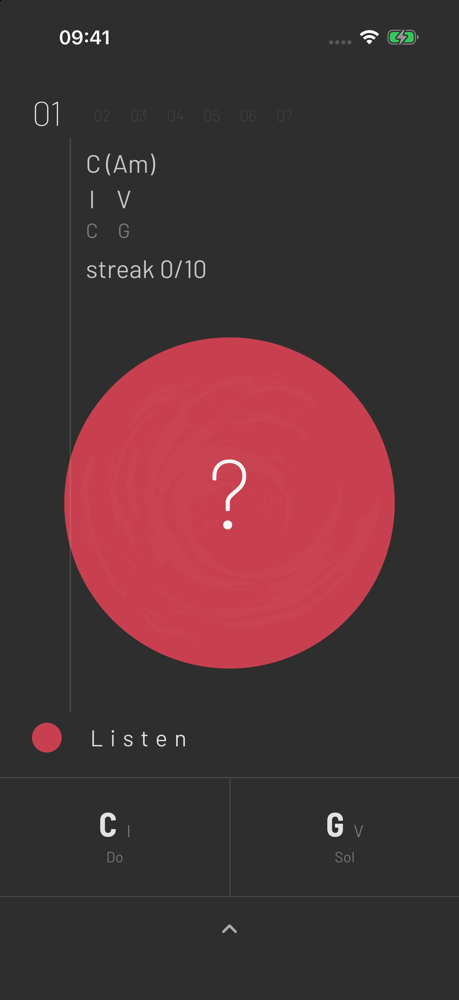
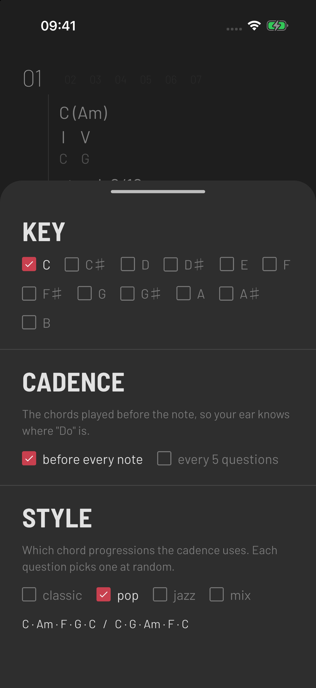

# Ears

A minimalist ear-training app built with Flutter. Ears trains **relative pitch** by ear only, with no sheet music: you hear a short chord progression that sets the key, then a single note. Your job is to name that note's scale degree.

<p align="center">
  
  &nbsp;&nbsp;&nbsp;
  
</p>

## How it works

1. Tap the circle. A cadence plays (for example C · F · G · C) so your ear locks onto the tonic, "Do".
2. A single note follows. The circle shows **?**, so the answer stays hidden.
3. Tap the note you heard at the bottom of the screen. Each button shows the note name, its scale degree and its solfège syllable (**C I Do**).
   - **Correct:** the note resolves step by step to the tonic (for example E → D → C), with each note shown in the circle as it sounds. The next question starts automatically.
   - **Wrong:** your answer is crossed out, and you hear your note followed by the real one. Then you can try again.
4. Tap the circle during a question to hear it again.

While a phrase plays, the circle shows each chord or note as it sounds.

## Levels

Each level adds scale degrees, starting with just the tonic and the dominant:

| Level | Degrees |
|---|---|
| 01 | I · V |
| 02 | I · IV · V |
| 03 | I · III · V |
| 04 | I · III · IV · V |
| 05 | I – V |
| 06 | I – VI |
| 07 | I – VII (full major scale) |

The next level unlocks after **10 correct answers in a row**. The top of the screen shows the key with its relative minor, for example **C (Am)**, the current degrees with their note names, your streak, and your ✓ correct / ✗ wrong counts.

## Settings

Swipe up or tap **^** to open the settings.

- **Key:** all 12 major keys, named with sharps (C, C♯, D … B).
- **Cadence:** play the chords before every note, or only every 5 questions for a harder workout.
- **Style:** which progressions the cadence uses. Each question picks one at random.
  - **classic:** I–IV–V–I, I–IV–I–V–I
  - **pop:** I–vi–IV–V–I, I–V–vi–IV–I
  - **jazz:** I–ii–V–I, I–vi–ii–V–I
  - **mix:** all of the above

## Under the hood

- **No audio samples.** A small additive synthesizer written in Dart (`lib/audio/synth.dart`) renders each phrase to a WAV in memory, which is then played with [`audioplayers`](https://pub.dev/packages/audioplayers). Rendering the whole phrase at once keeps the timing exact on every platform.
- **Music theory** (scales, chord voicings, progressions, resolutions) lives in `lib/model/theory.dart`.
- **Trainer logic** (questions, streaks, unlocking, timed captions) lives in `lib/model/trainer.dart`.
- Progress and settings are saved with `shared_preferences`.

## Running

```bash
flutter pub get
flutter run
```

Runs on iOS and Android, with web and macOS builds also set up.
